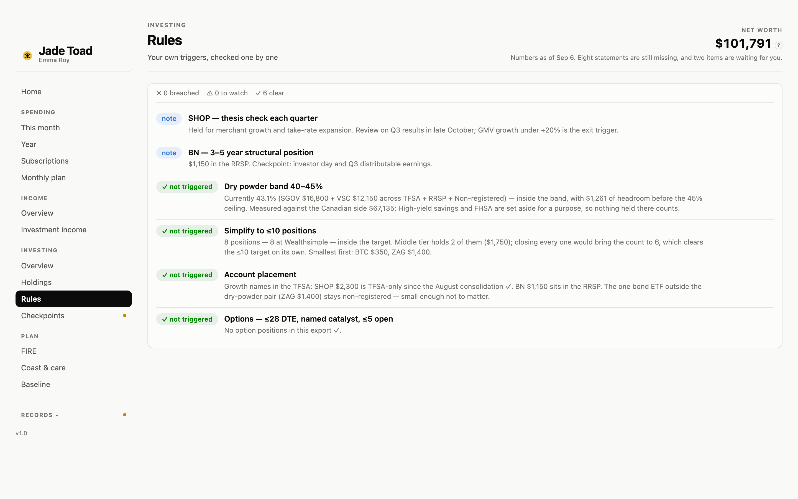

<p align="right"><b>English</b> · <a href="README.zh.md">中文</a></p>

<p align="center">
  
</p>

# Jade Toad

**Your money, on one page, kept honest by a set of checkers.**

Once a month you drop your bank statements and broker exports into a folder and say
*"update dashboards"*. Claude Code reads them, checks that every statement adds up, files every
purchase, rebuilds the dashboard and tells you what changed. No server, no bank login, no app:
one folder of plain CSV and JSON, and one HTML page you open in a browser. Your statements and
your data stay in that folder, and the import is a local script. What Claude reads is its
summary — a merchant it has not seen, a statement no parser could read, your answers — and that
goes to Anthropic the way anything you say in Claude Code does. A statement a parser read never
does.

## What you see

| | |
|---|---|
|  | **Home.** What needs you today, worst first, each line opening the page where it is dealt with. Net worth in one card: a row for what each part is for, its bar coloured by how easily you could reach it. Two dates under the net worth: the day every account is complete to, and the last update. |
|  | **Spending.** This month, opened up by category; the year, month by month and against the allowance; subscriptions, with what is due in the next 30 days. No category caps — one allowance, and everything under it is guilt-free. |
|  | **Plan.** What each paycheque is for; how far the portfolio is from the FIRE target and when it gets there; whether the money lasts once you start taking it out, replayed through every stretch of real years since 1928. |
|  | **Investing.** What you hold and how it splits; how it did against one fund you could have bought instead; your own rules — a cash band, where each holding belongs, the theses you wrote down — checked one by one. |
|  | **Records.** Everything waiting for you in one place; what each update changed; every account; which statement arrived which month; and a glossary of every term the page uses. |

**Every word on a card is chosen.** A card has a label, one number and at most one fact. A
term with a dotted underline shows its dictionary entry and opens the Glossary; a number with
one shows the sum behind it. (Home, the header and Spending work this way; the other groups
follow in the next release — see the [roadmap](ROADMAP.md).)

### Every page

| Section | Page | What it answers |
|---|---|---|
| — | Home | What needs you today, and what you are worth |
| Spending | This month | How much is still free to spend, and where the money went |
| | Year | How the year went, by category and month by month |
| | Subscriptions | What repeats, what it costs a year, what is due next |
| Income | Income | What came in, by source, and how much of it you kept |
| | Investment income | What the portfolio paid you before you sold anything |
| Investing | Portfolio | What is invested, by currency, by kind of asset and by bucket |
| | Performance | How it did against one benchmark fund bought on the same days |
| | Holdings | Every position, by role or by account |
| | Rules | Each of your rules, checked today |
| Plan | Budget | What each paycheque is for, and what the funds hold |
| | FIRE | How far the portfolio is from the target, and when it gets there |
| | Drawdown & care | Whether the money lasts, care included, and in how many real stretches of history it would have |
| | Spending baseline | The monthly figure the target is built on, against what you really spend |
| Records | To do | Questions, checks and tasks waiting for you |
| | Updates | What each update changed |
| | Accounts | Every place the money sits |
| | Statements | Which statement arrived which month, and what is missing |
| | Glossary | Every finance term, and every word the page coined |

### New since the first release

- **To do** gathers what waits on you, which used to sit on two pages with two counts.
- **Performance**: the same money put into one fund you name, on the days it actually went in.
- **Would it have lasted?** The drawdown replayed through every stretch of real years since
  1928, mixed the way your portfolio is today.
- **Coast to FIRE**: the age today's money reaches the target with nothing more added.
- **Glossary**, dotted-underline terms and numbers that open their sum.
- **Fetching statements**: once you have signed in to your bank yourself, Claude works out
  which statements are missing, asks once, downloads them and files them into `inbox/`.
- Net worth in one card instead of two; negative money reads −$61; the header says two dates.

## Try it in one minute

Nothing to install. Clone the repository and open `dashboards/finance_dashboard.html` in a
browser (desktop, at least 1120px wide).

What you are looking at is a year in the life of **Emma Roy**, 31, a project coordinator in
Ottawa who does not exist. Every number is synthetic, and every balance chain still closes,
because the checkers would not have let the page build otherwise.

## Make it yours in twenty minutes

You need [Claude Code](https://claude.com/claude-code), Python 3.9 or newer, a folder that syncs
between your devices (iCloud Drive, OneDrive, Dropbox — so a statement photographed on your phone
is on your laptop), and last month's statements. That is all; no bank connection and no
subscription.

1. **Drop last month's files into `inbox/`**, filenames untouched: every bank statement, your
   broker's holdings and activities exports, a screenshot of anything held abroad.
2. **Say "set this up"** in Claude Code, inside your copy. It reads those files and drafts your
   accounts, the files you get each month and your monthly plan, and shows them to you as
   tables. You correct what's wrong and answer what the files can't say — your name, what an
   account is for, how you invest — about a dozen questions. Nothing is written until every one
   is answered.
3. **Say "update dashboards".** The same files become your first import, and the page fills in.
4. **Read what it asks you.** A merchant it has not seen, a transfer it could not name: each one
   waits on Records → Updates with the default it applied meanwhile. Say the word and it is filed.

Two things worth knowing before you start:

- `pip3 install --user pypdf` lets the statement parsers read your PDFs. Without it, Claude
  reads each statement by hand — slower, but it works.
- Keep your real data out of any public repository. The shipped `.gitignore` protects `inbox/`
  and `archive/`, but the demo's `findata/` is tracked; the moment yours is real, run
  `git rm -r --cached findata` and uncomment the `findata/` line in `.gitignore`.

> **Who it is for.** Someone in Canada with a paycheque, a few accounts at one or two of the big
> five banks, a broker, and a plan they want held to. The tax-sheltered accounts it knows are the
> TFSA, RRSP and FHSA, the money is Canadian dollars, and the retirement arithmetic assumes CPP
> and OAS. Statements are read by parsers, one per bank and kind of statement: today RBC and BMO,
> and Wealthsimple's exports. TD, Scotiabank and CIBC come next, then Questrade and Interactive
> Brokers, in that order. Until a parser exists for your bank, Claude reads those statements by
> hand — slower, and it means it sees them. Everything else — the accounts, the categories, the
> investing rules — is data you set in the interview, so nothing stops you elsewhere.

## What a month looks like

1. **Import day** (the 26th by default; a reminder lists what has arrived and what is missing).
   Download the month's statements into `inbox/`. Leave the bank's filenames alone — that is how
   each file is recognised.
2. **Say "update dashboards".** One local script does the month: every file is named and checked
   for duplicates before anything is touched; each statement is read by its parser and has to
   reconcile to its own totals before a row is written; purchases are filed by merchant; the page
   is rebuilt; the originals move to `archive/`. Claude reads only the script's summary and puts
   to you what a program cannot decide — a merchant it has not seen, a statement no parser could
   read — and you get a short report: what changed, what was noticed, what was decided without
   asking, what needs your word.
3. **Open the page.** Records → Statements shows which month got which file, so a gap is
   visible at a glance.

For Emma the monthly drop is eight files: three RBC PDFs, three BMO PDFs and two Wealthsimple
exports. Yours is whatever your register says.

## Why the numbers can be trusted

Every figure on the page is built from the data folder, never typed. Four checkers hold that
line, and a fifth checks the checkers:

- **Does the money add up** — every ledger's balance chain closes, every statement reconciles to
  its own totals, a repayment is never counted as income, the register agrees with its sources.
- **Does the page follow its design rules** — chart heights, line widths, contrast, navigation
  against sections, this README against the real pages.
- **Does it actually draw** — a headless browser opens every page at three widths and looks for
  anything that failed to render.
<!-- LINT:FAULTS n=56 -->
- **Are the checkers still checking** — a selftest plants 56 specific faults in a copy of the
  workspace and asserts each one is caught. It exists because a checker once linted an empty
  folder and reported success.

A clean run is silent. Anything else is a numbered finding, grouped by what went wrong.

<details>
<summary>Run them yourself</summary>

```bash
python3 .claude/skills/workspace-checks/scripts/check_data.py .
python3 .claude/skills/workspace-checks/scripts/check_design.py dashboards/finance_dashboard.html
python3 .claude/skills/workspace-checks/scripts/check_render.py dashboards/finance_dashboard.html
python3 .claude/skills/workspace-checks/scripts/selftest.py .
```

`check_data.py` is the one to start with; `-v` lists what passed. `check_render.py` needs Playwright
(`pip3 install --user playwright && python3 -m playwright install chromium`).
</details>

## Under the hood

<details>
<summary>The folder</summary>

```
inbox/        drop new files here; they move to archive/ once processed
findata/      the only source of truth, three folders by who writes them:
  register/     what you declare — accounts, plan, rules, merchants
  ledgers/      what the import writes — every ledger, purchases, the broker's exports
  history/      what each update leaves behind — updates, decisions, filings, snapshots
dashboards/   the built page (one self-contained HTML file)
templates/    the page code with every number empty; dashboards/ is built from it
archive/      processed originals, named <date>_<source>_<original name>
docs/         the pipeline diagram and the Chinese guide
.claude/      the three skills: setup, update-dashboard, workspace-checks
tools/        demo data, migrations, sync into a workspace
```

The folder is called `findata/` because iCloud for Windows refuses to sync any folder named
`data`. That one cost a day.
</details>

<details>
<summary>The pipeline</summary>


*Editable source: [`docs/pipeline.drawio`](docs/pipeline.drawio), generated by `docs/pipeline.py`.*
</details>

<details>
<summary>The documents that govern it</summary>

| File | Owns |
|---|---|
| [`PRODUCT.md`](PRODUCT.md) | what the product is for, its principles, and what it deliberately is not |
| `CLAUDE.md` | how Claude works here: the information model, the import, the checkers |
| `FINANCE.md` | the money logic: the FIRE target, pay-yourself-first, what counts as income |
| `DESIGN.md` | how the page looks and talks: palette, navigation, copy |
| `OWNER.md` | **yours** — your banks, your traps, your decisions; the other three name nobody |

They are rules, not notes: each line was written after something went wrong, and they are read
before every change. Anything agreed out loud has to land in one of them or it does not survive
the next session.
</details>

<details>
<summary>The tool and your workspace</summary>

This repository is the tool. Your workspace — the synced folder with your `findata/`, your
`inbox/`, your `OWNER.md` — is an instance of it. `tools/sync.py <workspace>` copies the skills,
the templates and the governing documents into it and touches nothing that is yours; when the
tool's data shape moves ahead of your folder, `tools/migrate.py <workspace>` brings the folder
up one step at a time.

<!-- LINT:NAV main=19/5 minwidth=1120 -->
The page is 19 pages in 5 sidebar groups —
Home · Spending · Income · Investing · Plan · Records
— desktop only, at least 1120px wide.
</details>

## What's next

The next releases and their target dates are in [`ROADMAP.md`](ROADMAP.md); what already
shipped is in [`CHANGELOG.md`](CHANGELOG.md).

## Licence

MIT — see [`LICENSE`](LICENSE).
